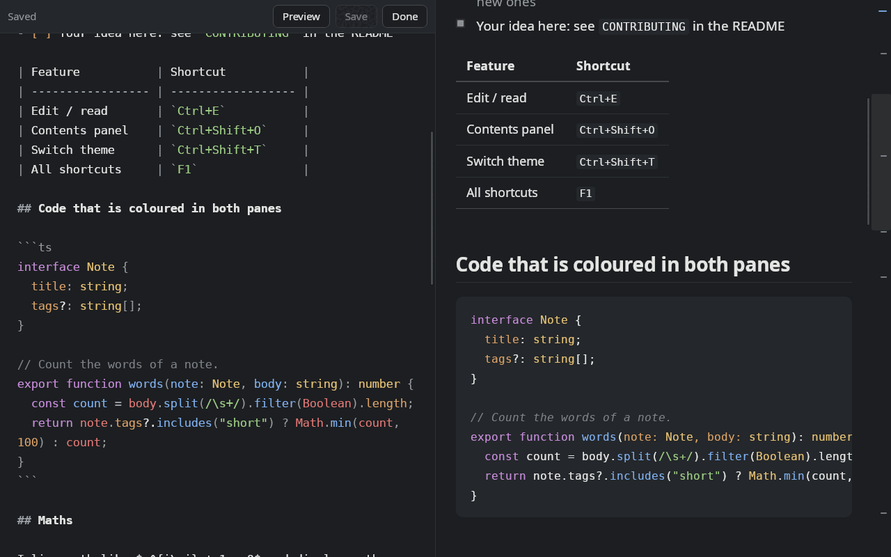
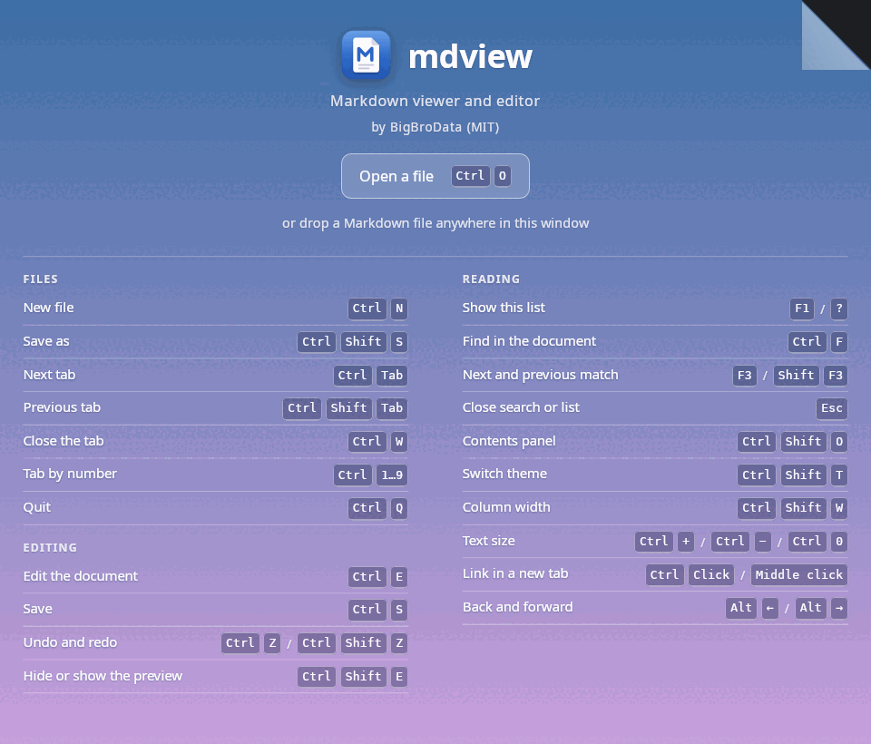
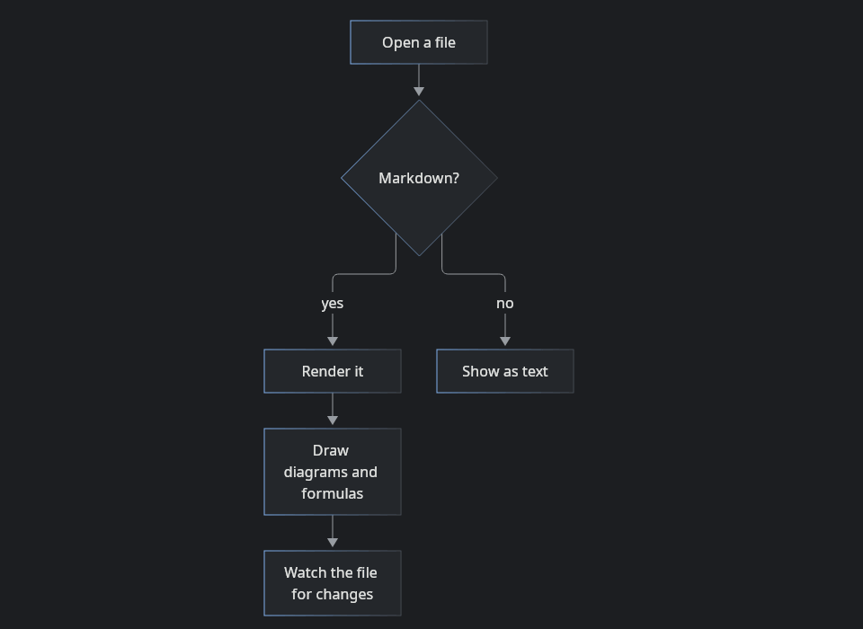

# mdview

A small, fast **Markdown viewer and editor** for Linux. Double-click a `.md` file and read it; press `Ctrl+E` and edit it
with a live preview beside the text. It is a desktop app (Tauri 2, a `.deb` package for Debian and Ubuntu) and also a
local Bun server that shows a file in your browser. Current version: **0.3.0**.



## Screenshots

| Start screen | A Mermaid diagram in the colours of the theme |
| --- | --- |
|  |  |

The screenshots show the demo document, [docs/demo.md](docs/demo.md): open it with `mdview docs/demo.md` to see the same page.

## Features

**Reading**

- GitHub-flavoured Markdown: tables, task lists, strikethrough, autolinks.
- Math with KaTeX: `$inline$`, `$$display$$` and ` ```math ` blocks.
- Code highlighting (highlight.js, the common languages).
- **Mermaid diagrams** (` ```mermaid `), drawn in the colours of the current theme. The library loads only in a document
  that has a diagram; a mistake in a diagram leaves the code and the reason instead of breaking the page.
- **Raw HTML** (`<kbd>`, `<details>`, ``, tables) is cleaned by DOMPurify with extra restrictions: no `<style>`,
  `<link>`, forms, frames or media, and `position`, `z-index` and URLs are removed from `style`. Scripts never run.
- Images next to the document (relative paths, only from the document's folder) and `https://` images.
- `.mdx` files: Markdown as usual, `import`/`export` lines as a muted code block, JSX tags as quiet chips (components are
  not executed). A YAML front matter block is shown as a muted block.
- Links: `#anchor` scrolls to a heading (GitHub-style ids, Cyrillic included), a link to a neighbouring `.md` opens in the same
  window, `https://` and `mailto:` go to your default browser. `Alt+←` / `Alt+→` (or the mouse side buttons) go back and
  forward and return to the same place.
- Live reload: save the file in any editor and the page updates in place, keeping the scroll position.
- Search (`Ctrl+F`), a contents panel (`Ctrl+Shift+O`) and a heading ribbon at the right edge for long documents.
- Light and dark themes follow the system. Extra themes are plain CSS files (see [Themes](#themes)).
- Column width (`Ctrl+Shift+W`) and text size (`Ctrl`+`+` / `-` / `0`), remembered between runs. The window remembers its size too.

**Editing**

- `Ctrl+E` turns the open document into a CodeMirror 6 editor with a live preview. The two panes scroll together in both
  directions. `Ctrl+S` saves; `Ctrl+E` (or **Done**) returns to reading.
- Code inside ` ``` ` fences is highlighted by language in the editor too (17 languages, each loaded only when met).
- Every tab has its own text, cursor and undo history. Changes are never lost silently: closing a tab or the window asks
  **Save / Discard / Cancel**. If the file changed on disk while you have unsaved edits, the first `Ctrl+S` only warns you
  and the second overwrites. Line endings (CRLF) and a BOM are kept.
- New file (`Ctrl+N`) and **Save as** (`Ctrl+Shift+S`). While reading, `Ctrl+Shift+S` saves a byte-for-byte copy of the file,
  which is also a way to copy a read-only file.
- The divider between the editor and the preview can be dragged (double click resets it, `←` `→` on it move it by 2 %).
  `Ctrl+Shift+E` hides the preview and leaves the editor alone.
- Shortcuts work on non-Latin keyboard layouts (they follow the physical key).

**Tabs and files**

- One window per user: `mdview other.md` while a window is open adds a tab to it. Drag and drop, `Ctrl+O` and selecting several files
  in the file manager do the same. `Ctrl+click` (or middle click) on a link opens it in a new tab.
- `Ctrl+W` closes a tab (closing the last one leaves the start screen); `Ctrl+Q` quits and asks about unsaved changes.
- `F1` (or `?`) shows every command with its keys over the document. The start screen shows the same list.

## Install

### Debian, Ubuntu and derivatives: the `.deb` package

This covers Debian, Ubuntu, Linux Mint, Pop!_OS, elementary OS and the other distributions that use `apt`. You need
`libwebkit2gtk-4.1-0` and `libgtk-3-0`, which come with Ubuntu 22.04 or newer and Debian 12 or newer and are installed
automatically.

Download `mdview_0.3.0_amd64.deb` from the Releases page, then:

```bash
sudo apt install ./mdview_0.3.0_amd64.deb
```

```bash
mdview docs/demo.md
```

After installing, `.md` and `.mdx` files open with a double click (mdview registers `text/markdown` and `text/mdx`). If your file
manager offers another program, pick mdview once under **Open with**. To remove it: `sudo apt remove mdview`.

### Any Linux: build from source

You do not need a package to use mdview: build it yourself and run the binary. Three things are needed.

**1. Bun 1.3 or newer** ([bun.sh](https://bun.sh)) and **Rust** (stable, via [rustup](https://rustup.rs)):

```bash
curl -fsSL https://bun.sh/install | bash
```

```bash
curl --proto '=https' --tlsv1.2 https://sh.rustup.rs -sSf | sh
```

Open a new terminal afterwards (or run `source ~/.cargo/env`).

**2. The system libraries of Tauri 2** (WebKitGTK 4.1 and a C toolchain):

```bash
# Debian, Ubuntu and derivatives
sudo apt update && sudo apt install -y libwebkit2gtk-4.1-dev build-essential curl wget file libxdo-dev libssl-dev libayatana-appindicator3-dev librsvg2-dev
```

```bash
# Fedora
sudo dnf install webkit2gtk4.1-devel openssl-devel curl wget file libappindicator-gtk3-devel librsvg2-devel libxdo-devel && sudo dnf group install "c-development"
```

```bash
# Arch and derivatives
sudo pacman -S --needed webkit2gtk-4.1 base-devel curl wget file openssl appmenu-gtk-module libappindicator-gtk3 librsvg xdotool
```

```bash
# openSUSE
sudo zypper in webkit2gtk3-devel libopenssl-devel curl wget file libappindicator3-1 librsvg-devel && sudo zypper in -t pattern devel_basis
```

These lists come from the [Tauri prerequisites](https://v2.tauri.app/start/prerequisites/#linux). The author builds and tests on
Pop!_OS 22.04 (X11); the other lists were not tried here. If a package name has changed in your release, the Tauri page is
the place to look.

**3. Build and install for your user** (no `sudo`, no package):

```bash
git clone <repository-url> mdview && cd mdview
bun install
bun run desktop:build -- --no-bundle
```

The binary is `src-tauri/target/release/mdview`; the page is built into it, so it runs on its own. Put it where your
launcher can find it:

```bash
install -Dm755 src-tauri/target/release/mdview ~/.local/bin/mdview
install -Dm644 src-tauri/icons/128x128.png ~/.local/share/icons/hicolor/128x128/apps/mdview.png
install -Dm644 src-tauri/mime/mdview.xml ~/.local/share/mime/packages/mdview.xml
```

```bash
cat > ~/.local/share/applications/mdview.desktop <<EOF
[Desktop Entry]
Type=Application
Name=mdview
Comment=Lightweight Markdown viewer
Exec=$HOME/.local/bin/mdview %F
Icon=mdview
Terminal=false
Categories=Utility;
StartupWMClass=mdview
MimeType=text/markdown;text/mdx;
EOF
update-mime-database ~/.local/share/mime
update-desktop-database ~/.local/share/applications
```

mdview now appears in the application menu and in **Open with** for Markdown files. (`~/.local/bin` must be on your `PATH` to
type `mdview` in a terminal.) To build your own `.deb` instead, run `bun run desktop:build`; it appears in
`src-tauri/target/release/bundle/deb/`.

### In a browser, without Rust

The Bun server shows a file in your browser (reading only: editing needs the desktop window). It needs only Bun:

```bash
bun install
bun run start -- path/to/file.md --open
```

The terminal prints an address such as `http://127.0.0.1:3737/`; `--open` opens it for you. Stop with `Ctrl+C`.

| Option     | Meaning                                                                                       |
| ---------- | --------------------------------------------------------------------------------------------- |
| `--port N` | port (default 3737; `0` picks any free one)                                                   |
| `--open`   | open the page in the default browser (`xdg-open`)                                             |
| `--dev`    | rebuild the page code on every request (for working on mdview itself; styles refresh on reload) |

The server listens on `127.0.0.1` only, so it cannot be reached from outside the machine.

## Keyboard shortcuts

Press `F1` in the app to see them any time.

| Keys | Action |
| --- | --- |
| `F1` or `?` | all shortcuts |
| `Ctrl+O` | open a file (in a new tab) |
| `Ctrl+N` | new file |
| `Ctrl+E` | edit / read |
| `Ctrl+S` | save (in the editor) |
| `Ctrl+Shift+S` | save as (while reading: save a copy) |
| `Ctrl+Shift+E` | hide or show the preview |
| `Ctrl+W` / `Ctrl+Q` | close the tab / quit |
| `Ctrl+Tab`, `Ctrl+Shift+Tab` | next and previous tab (also `Ctrl+PgDn` / `Ctrl+PgUp`) |
| `Ctrl+1`…`8`, `Ctrl+9` | tab by number, last tab |
| `Alt+←` / `Alt+→` | back and forward |
| `Ctrl+F`, `F3` / `Shift+F3` | find, next and previous match |
| `Ctrl+Shift+O` | contents panel |
| `Ctrl+Shift+T` | switch theme |
| `Ctrl+Shift+W` | column width |
| `Ctrl`+`+`, `Ctrl`+`-`, `Ctrl+0` | text size |

## Themes

Besides the built-in light and dark looks there are `sepia`, `dusk` and `contrast`. `Ctrl+Shift+T` opens the list: the arrow
keys preview a theme at once, `Enter` keeps it and `Esc` cancels. A theme is a CSS file that overrides a few variables, so you
can add your own as `~/.config/mdview/themes/<name>.css`. The format and the full list of variables are in
[docs/themes.md](docs/themes.md).

## Network access

Only `https://` images that the document itself refers to (the desktop window loads them the way GitHub does). KaTeX fonts and
all scripts are bundled; `http://` images are not loaded.

## Troubleshooting

- `mdview: file not found`: the path is wrong; it is taken from the current folder.
- `mdview: port 3737 is busy` (browser mode): another instance runs; use `--port 0`.
- The page says "Connection to viewer lost" (browser mode): the server stopped; start it again and reload the page.
- An image is missing: it lies outside the document's folder (for example `../img.png`); mdview refuses such paths on purpose.
- The build stops with `cargo metadata … No such file or directory`: Rust is not on your `PATH`; open a new terminal or run `source ~/.cargo/env`.
- The build cannot find `webkit2gtk-4.1`: install the system libraries from step 2 above. The older 4.0 series is not enough.

## For developers

```
src/render/   Markdown to HTML: a pure function shared by the browser and the tests
src/server/   command line, HTTP server, file watching, client build
src/client/   the page: styles and browser code; platform/ is the "browser or Tauri" layer
src-tauri/    the Tauri 2 shell (Rust), package config, .desktop template
tests/        bun test; tests/fixtures holds sample documents
docs/         decisions.md (why it is like this), backlog.md (what is postponed),
              changelog.md, themes.md, demo.md, images/
```

```bash
bun run check      # types + linter + tests (all must pass)
bun test           # tests only
bun run build      # the static client into dist/
bun run desktop:dev   # a development window with a live-rebuilt client
cd src-tauri && cargo test   # tests of the Rust shell
```

## License

MIT, © 2026 BigBroData. The full text is in [LICENSE](LICENSE): you may use, change, distribute and include the program in your own
projects as long as you keep the copyright notice and the licence text. There is no warranty ("as is"). The libraries mdview
uses (CodeMirror, markdown-it, KaTeX, highlight.js, DOMPurify, Mermaid, Tauri and others) have their own licences, compatible
with MIT, listed in `package.json` and `src-tauri/Cargo.toml`.

## Contributing

Help is welcome: bug reports, ideas, fixes and new features. What is planned and what was left out on purpose is in
[docs/backlog.md](docs/backlog.md); why things are built the way they are is in [docs/decisions.md](docs/decisions.md). Please
read both before a large change.

**Getting started**

```bash
bun install
bun run start -- README.md --dev   # live view in the browser, the client rebuilds on every request
bun run check                      # types + linter + tests: must be clean before you send a change
```

The desktop window needs Rust and the Tauri system libraries (see [Install](#install)); `cargo test` in `src-tauri/` runs the
shell's tests.

**The rules that keep the project tidy**

1. **Small commits with English messages.** One commit, one idea; "what and why" in the first line.
2. **Tests for new logic.** Pure functions are tested in `tests/` (`bun test`). Window behaviour is best tried by hand (or in a
   nested X server), and what was checked is noted in `docs/decisions.md`.
3. **A new key goes in the list.** Add the command to `commandGroups` (`src/client/start-screen.ts`) in the same commit as its
   handler: the list is shown on the start screen and by `F1`, and a test watches it.
4. **Lightness is a product requirement.** Do not add a dependency for a small thing; heavy parts load lazily (like diagrams and
   highlighting languages). Package size and first paint matter more than "just in case" features.
5. **Safety is not loosened.** Raw HTML goes through `src/render/sanitize.ts`, the window's content security policy
   (`src-tauri/tauri.conf.json`) is not widened without a strong reason, and writing to disk goes only through the checks in
   `save.rs`.
6. **Biome sets the style** (`bun x biome check --write src tests`); do not argue with the formatting.
7. **Documentation is in English** (README, `docs/`, code comments and commit messages).

**How to propose a change.** Open an issue or a pull request in the project's repository, or write to the author, BigBroData:
**sheyhali34@gmail.com**. Describe the problem or the idea, attach the output of `bun run check` if you can, and, if the change is
ready, the patch itself (`git format-patch`) or a link to a branch. By sending a change you agree that it is distributed under the
same MIT licence.
