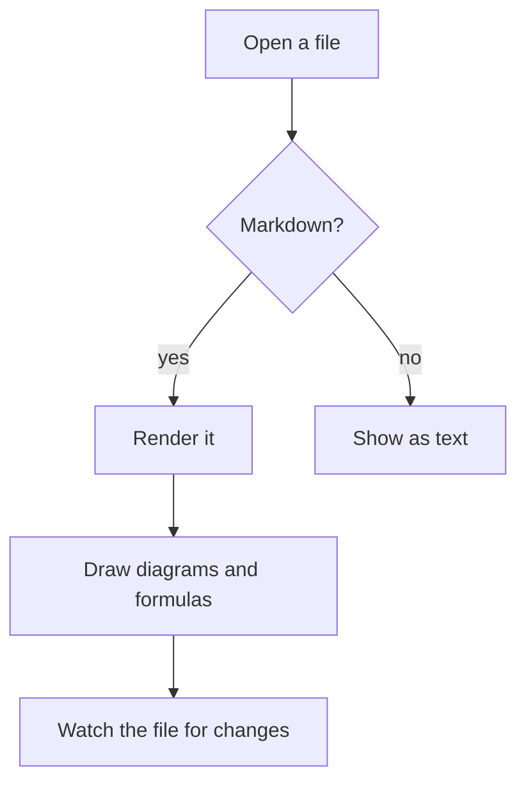
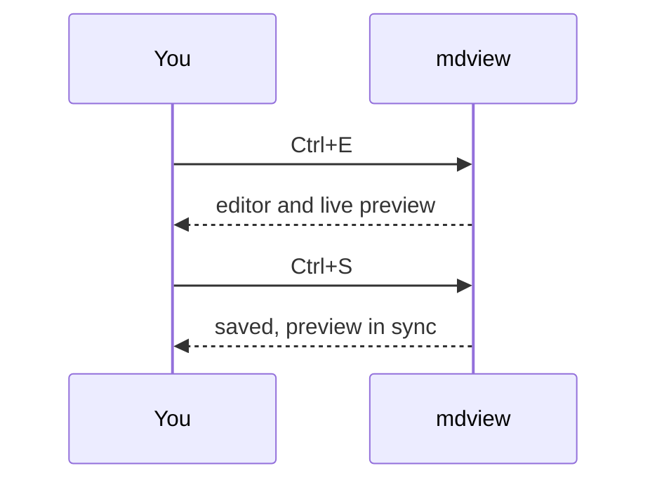

# Welcome to mdview

A small, fast Markdown **viewer and editor**. Open this file with `mdview docs/demo.md` and press **Ctrl+E** to edit it: the preview on the right follows your cursor.

## Everything you expect

- [x] GitHub flavoured Markdown: tables, task lists, strikethrough, autolinks
- [x] Live reload: save the file in any editor and the page updates in place
- [x] Themes are plain CSS files, so you (or an agent) can write new ones
- [ ] Your idea here: see `CONTRIBUTING` in the README

| Feature           | Shortcut           |
| ----------------- | ------------------ |
| Edit / read       | `Ctrl+E`           |
| Contents panel    | `Ctrl+Shift+O`     |
| Switch theme      | `Ctrl+Shift+T`     |
| All shortcuts     | `F1`               |

## Code that is coloured in both panes

```ts
interface Note {
  title: string;
  tags?: string[];
}

// Count the words of a note.
export function words(note: Note, body: string): number {
  const count = body.split(/\s+/).filter(Boolean).length;
  return note.tags?.includes("short") ? Math.min(count, 100) : count;
}
```

## Maths

Inline math like $e^{i\pi} + 1 = 0$ and display math:

$$
\int_{-\infty}^{\infty} e^{-x^2}\,dx = \sqrt{\pi}
$$

## Diagrams

A Mermaid diagram is drawn in the colours of the current theme:





## Raw HTML is welcome, safely

Press <kbd>Ctrl</kbd>+<kbd>S</kbd> to save, water is H<sub>2</sub>O, and
<details>
<summary>this section folds</summary>

Scripts, styles and forms are removed before anything is shown.

</details>
