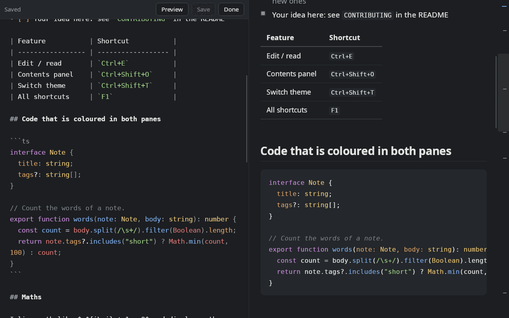

# mdview 0.3.0

A small, fast Markdown viewer and editor for Linux. Double-click a `.md` file to read it; press `Ctrl+E` to edit it with a live
preview beside the text.



## Highlights

- **Editor with live preview.** CodeMirror 6, the preview scrolls with you in both directions, code inside fences is coloured
  by language (17 languages), your work is never lost silently.
- **New file and Save as** (`Ctrl+N`, `Ctrl+Shift+S`); while reading, `Ctrl+Shift+S` saves a copy of the file.
- **Mermaid diagrams**, drawn in the colours of the current theme.
- **Raw HTML** in documents (`<kbd>`, `<details>`, images with a width), cleaned by DOMPurify. Scripts never run.
- **A start screen with every command**, and `F1` shows the same list over any document.
- A draggable divider between the editor and the preview, an editor-only mode (`Ctrl+Shift+E`), and a window that remembers
  its size.
- `Ctrl+W` on the last tab keeps the app open on the start screen; `Ctrl+Q` quits.
- MIT licence, © BigBroData.

The full list of changes is in [changelog.md](changelog.md).

## Install

**Debian, Ubuntu, Linux Mint, Pop!_OS and the other `apt`-based distributions** (Ubuntu 22.04 / Debian 12 or newer):

```bash
sudo apt install ./mdview_0.3.0_amd64.deb
```

The package depends on `libwebkit2gtk-4.1-0` and `libgtk-3-0`; `apt` installs them. After that `.md` and `.mdx` files open with a
double click, or from a terminal:

```bash
mdview notes.md
```

Remove it with `sudo apt remove mdview`.

**Any other Linux:** build from source, with no package needed. Step by step instructions, including the system libraries
for Fedora, Arch and openSUSE, are in the [README](../README.md#any-linux-build-from-source).

## Download

| File | Size | SHA-256 |
| --- | --- | --- |
| `mdview_0.3.0_amd64.deb` | 4.5 MiB | `4d7d8d6706dc2024fa7a1ddd32964ebd3b1093b84493b0fa7ef9341dfba32928` |

Check the download with `sha256sum mdview_0.3.0_amd64.deb`.

## Known limitations

- Built and tested on Pop!_OS 22.04. Other distributions and the dependency lists for them are not tested.
- The package is for `amd64` only.
- Very large Mermaid diagrams (hundreds of nodes) and diagrams inside `.mdx` files were not tried; in `.mdx` a Mermaid block is
  shown as code.
- In editor mode the scroll bars of the panes were seen showing through an open dialog in a nested X server (cosmetic; not seen on a real desktop).
- Editing is available in the desktop window only; the browser mode (`bun run start -- file.md`) is for reading.

## Changes since 0.2.0

Added: new file, Save as, copy while reading, draggable divider, editor-only mode, two-way scroll sync, code highlighting in
the editor, raw HTML, Mermaid, remembered window size, the `F1` shortcuts window, the MIT licence. Changed: a gradient start
screen with a folded corner, `Ctrl+W` on the last tab, the client loads heavy parts only when needed.
